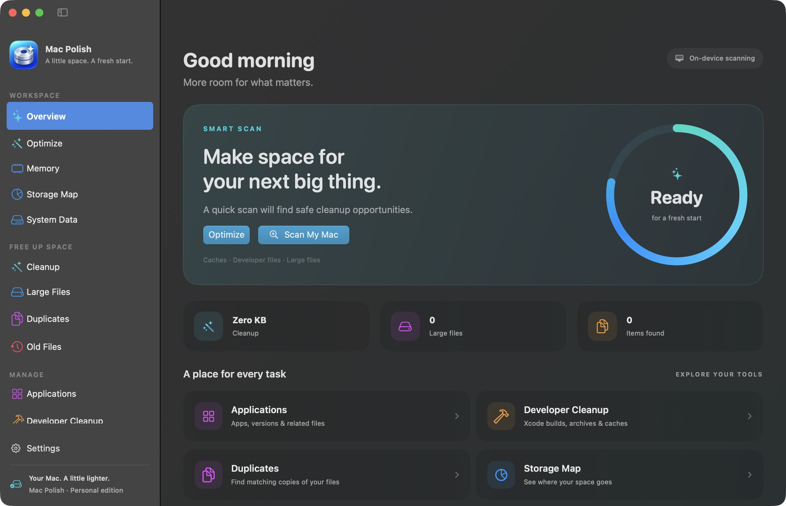
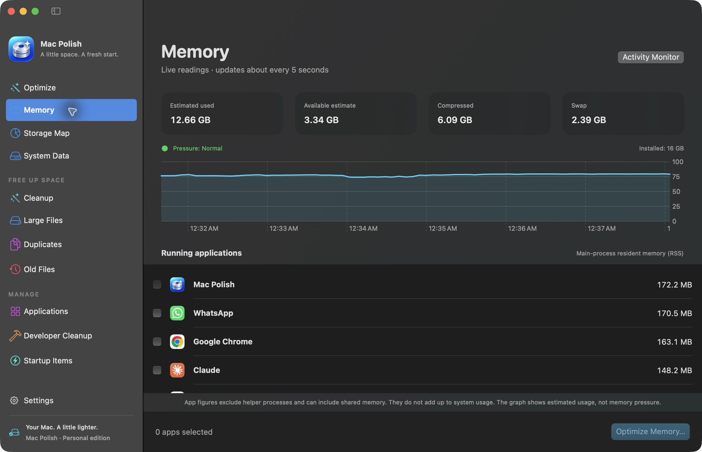
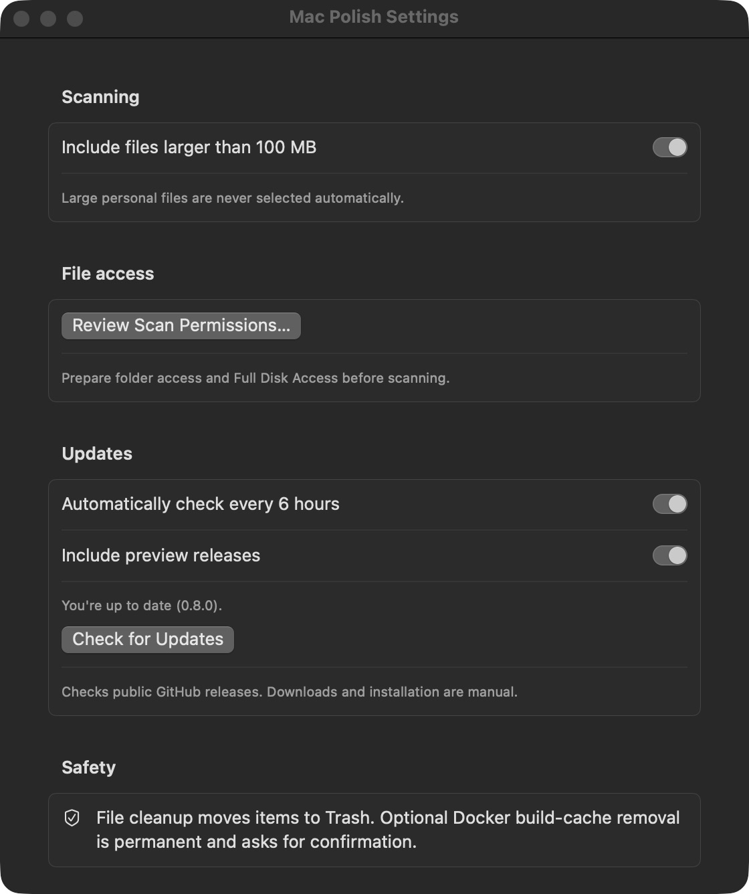
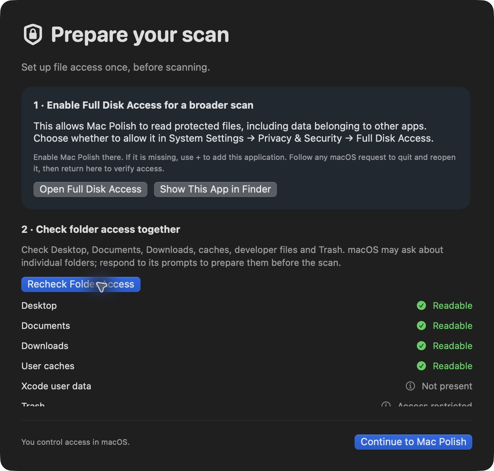

# Mac Polish

تطبيق شخصي لـmacOS يساعدك تفهم المساحة المستخدمة على جهازك، تكتشف الملفات الكبيرة والمكررة، وتراجع اقتراحات التنظيف قبل تنفيذها. مكتوب بـSwiftUI ويعمل محليًا.

## الجديد في 0.10.0

- إعداد الصلاحيات في خمس مراحل، مع فحص 16 موقعًا وحفظ المرحلة عند إعادة تشغيل التطبيق.
- فحص قرص أو مجلد تختاره وعرض كل الملفات الصغيرة والمخفية والفارغة داخل Storage Map.
- تحسين سرعة فحص المتكرر، الاحتفاظ بنتائجه المؤكدة عند انتهاء المهلة، ومنع احتساب الروابط الصلبة كنسخ إضافية.
- توضيح القياسات غير المكتملة وتقدير مساحة المتكرر على القرص بدل الاعتماد على حجم المحتوى فقط.

## الجديد في 0.9.2

- المثبّت بيحتفظ بنسخة سابقة واحدة كملف ZIP خارج Applications بدل ما تظهر نسخ إضافية من التطبيق.
- نقل مجلدات النسخ الاحتياطية القديمة المعروفة لسلة المهملات، وإزالة تسجيلها من Launch Services.
- شاشة الوصول بتنبهك لو فيه نسخ أخرى بتوقيع مختلف، مع تحسين التعامل مع أخطاء التثبيت.
- نفس شهادة التوقيع الثابتة المستخدمة في 0.9.1؛ لا حاجة لتغيير هوية التطبيق عند كل تحديث.

## الجديد في 0.9.1

- توقيع ثابت مع Hardened Runtime للإصدارات الجديدة. الانتقال من التوقيع السابق قد يحتاج منح الصلاحيات مرة أخرى؛ ثبات الهوية بين البناءات تم اختباره، واستمرار صلاحيات macOS الفعلي بعد التحديث ما زال يحتاج تحققًا.
- تحذيرات عند رفض قراءة أجزاء من الكاش أو ملفات أثناء فحص المتكررات.
- شاشة الوصول تعرض حالة الأماكن المختبرة بدل تأكيد Full Disk Access بـOn/Off.
- توضيح التطبيقات التي تحتاج مسؤولًا لإزالتها، وفحص المجلدات التي قد تطلب وصولًا بالتتابع.

## الجديد في 0.9.0

- خريطة تخزين للـData volume، مع توضيح الأجزاء غير المقروءة والمساحة غير المفسرة.
- حساب المساحة يراعي ملفات APFS المشتركة ويختار Data volume الخاص بالإقلاع عند وجود أكثر من نسخة macOS.
- المجلدات التي لم يكتمل فحصها لا تُحدد تلقائيًا ولا يقترحها Optimize؛ ويعاد التحقق قبل التنظيف.
- التنظيف ينقل الملفات إلى Trash بعد تأكيدك. هذه نسخة تجريبية لـApple Silicon بتوقيع ad-hoc، وليست موثقة لدى Apple.

## الجديد في 0.8.0

- زر **Settings** مباشر في أسفل القائمة الجانبية، ونافذة أوسع لعرض الخيارات.
- فحص الملفات في عمليات مستقلة بمهلة محددة، مع توضيح الفشل ومراجعة الوصول بدل استمرار الانتظار.
- **Last Cleanup** وتفاصيل كل ملف فشل نقله، مع فتح المسار في Finder ومراجعة الصلاحيات.
- إعادة التحقق من محتوى المكررات والنسخة المحتفَظ بها قبل النقل، وتخطي الملفات التي تغيّرت بعد الفحص.
- حماية مسارات `gomodcache` و`pkg/mod` و`node_modules` والروابط الرمزية من التنظيف كنسخ عادية.
- إصلاح أيقونة Dock، وتوضيح أن **Xcode user data** مجلد اختياري وليس فحصًا لتثبيت Command Line Tools.
- قياسات تشمل الملفات المخفية ومحتويات حزم التطبيقات، واختبارات معزولة لمسار Trash الحقيقي واستعادة الملفات التجريبية.

نتائج الاختبار وحدوده موثقة في [تقرير الإصدار 0.8.0](docs/release-0.8.0-validation.md).

## صور من التطبيق

لقطات فعلية من الإصدار **0.8.0**. أرقام الذاكرة وحالات الوصول الظاهرة تتغير حسب الجهاز والصلاحيات.

**الواجهة الرئيسية** — بداية الفحص وروابط أدوات إدارة المساحة.



<details>
<summary>متابعة الذاكرة — RAM وSwap وضغط الذاكرة</summary>

تعرض صفحة **Memory** القراءات الحية، الرسم البياني والتطبيقات المفتوحة، مع مراجعة الاختيار قبل طلب إغلاق أي تطبيق.



</details>

<details>
<summary>الإعدادات — الفحص والصلاحيات والتحديثات</summary>

افتح **Mac Polish → Settings…** من شريط القوائم، أو استخدم **⌘ ,** للوصول لإعدادات الفحص وتجهيز الصلاحيات والتحديثات.



</details>

<details>
<summary>تجهيز الصلاحيات — Prepare your scan</summary>

تجمع الشاشة خطوات Full Disk Access وفحص وصول المجلدات قبل بدء الفحص، وتوضح المجلدات المقروءة أو المقيدة أو غير الموجودة.



</details>

## إيه لازمته؟

- معرفة أين تذهب مساحة القرص، خصوصًا بيانات Docker وClaude وCursor وأدوات التطوير.
- جمع اقتراحات التنظيف في صفحة **Optimize** واحدة.
- اكتشاف الكاش والسجلات القديمة وملفات Xcode التي قد لا تحتاجها.
- العثور على الملفات الكبيرة والنسخ المتطابقة.
- مراجعة التطبيقات وبياناتها المرتبطة وعناصر التشغيل في الخلفية.

الهدف الأساسي هو استعادة مساحة وفهم التخزين. التطبيق لا يضمن تسريع الجهاز؛ حذف الكاش قد يجعل بعض المهام أبطأ مؤقتًا أثناء إعادة إنشائه.

## المتطلبات والتشغيل

### تثبيت الإصدار الجاهز

للأجهزة بمعالج Apple Silicon (M1 أو أحدث)، على macOS 14 أو أحدث:

```sh
curl -fsSL https://github.com/Abdel-RahmanSaied/Mac-Polish/releases/download/v0.10.0/install.sh | bash
```

يمكنك تنزيل السكريبت ومراجعته قبل تشغيله. يتحقق من SHA-256 والتوقيع المحلي، ويثبت التطبيق داخل `~/Applications` بدون sudo. أغلق التطبيق قبل تحديثه. يحفظ المثبّت الإصدار السابق كملف مضغوط واحد في `~/Library/Application Support/Mac Polish/Previous Version` بدل نسخة ثانية من التطبيق: macOS يحفظ إدخال صلاحيات واحدًا لـMac Polish، وأي نسخة إضافية تظهر في Launchpad وSpotlight قد تأخذ Full Disk Access من النسخة التي تستخدمها. ينقل المثبّت أيضًا مجلدات `MacPolish-backup.*` التي تركتها إصداراته السابقة داخل `~/Applications` إلى Trash. تعرض شاشة إعداد الصلاحيات أي نسخ أخرى من التطبيق مع زر Show in Finder، وتُفتح تلقائيًا إذا وجدت نسخة موقّعة بشكل مختلف. للتحقق من التحميل فقط دون التثبيت، شغّل السكريبت باستخدام `bash install.sh --verify-only`، ولتثبيت ملفات إصدار موجودة على جهازك استخدم `bash install.sh --from <المجلد>`.

النسخة موقعة محليًا وغير معتمدة من Apple عبر notarization؛ قد يطلب macOS السماح بتشغيلها من Privacy & Security. المثبّت لا يعطّل حماية النظام. الحزمة الحالية لا تدعم Intel.

### البناء من المصدر

- macOS 14 أو أحدث.
- للبناء من المصدر: Swift 6 وأدوات Apple للتطوير.
- لتفاصيل Docker وتنظيف كاش بنائه: Docker Desktop يعمل وDocker CLI متاح.

من Terminal:

```sh
cd Mac-Polish   # مجلد المستودع بعد clone
./Scripts/build-app.sh
open "dist/Mac Polish.app"
```

التطبيق الناتج موجود في `dist/Mac Polish.app` داخل مجلد المشروع ويمكن فتحه من Finder. بعد تحديث الكود، أعد البناء ثم أغلق النسخة المفتوحة وافتح التطبيق الجديد.

للتشغيل أثناء التطوير:

```sh
swift run MacPolish
```

إذا لم تظهر النافذة، استخدم نسخة التطبيق داخل `dist`. سكريبت البناء يوقّع بهوية المشروع الثابتة مع Hardened Runtime إن وُجدت (راجع CONTRIBUTING)، وإلا يوقّع ad-hoc مع تحذير؛ هذا ليس توقيع Developer ID أو اعتماد notarization للنشر العام.

## تجهيز صلاحيات الملفات أول مرة

نسخة التطوير الحالية فيها خمس شاشات إعداد قبل الفحص (الصور بالأعلى من إصدار سابق):

1. **Meet your Mac, in detail**: توضح نطاق الفحص وأن الإعداد لا يحذف ملفات.
2. **Unlock a broader view**: افتح **Open Full Disk Access** وفعّل نفس نسخة التطبيق من إعدادات macOS. زر **Show This App in Finder** يساعدك تختار النسخة الصحيحة. لو النظام طلب إعادة تشغيل التطبيق، الإعداد يكمل من نفس المرحلة.
3. **Check your folders**: اضغط **Check & Request Folder Access**. يتم فحص 16 موقعًا، بما فيها الملفات الشخصية والكاش وTrash وبيانات التطبيقات والـcontainers والبريد وSafari ومجلدات السحابة. النتائج تظهر أثناء الفحص؛ طلبات Desktop وDocuments وDownloads متتابعة.
4. **Prepare app removal**: رابط **App Management** اختياري لإزالة التطبيقات، وليس شرطًا لقياس المساحة. التطبيق لا يزيل أي شيء لاختبار هذه الصلاحية.
5. **Your scan readiness**: راجع المواقع المقيدة أو غير المتاحة، ثم افتح التطبيق أو اختر **Continue with limited access**. المجلد غير الموجود ليس خطأ صلاحيات.

داخل **Storage Map** استخدم **Inspect every item…** لعرض الملفات الصغيرة والمخفية والفارغة في المجلد، أو **Choose Disk or Folder…** لفحص قرص متصل أو مجلد تختاره. العرض يحمل 200 صف كل مرة مع زر لإظهار المزيد؛ لا يستبعد باقي الملفات من القياس. المجلدات الفرعية تُفحص على نفس وحدة التخزين؛ الوحدات المركبة الأخرى تُختار وتُفحص منفصلة. الملفات المتاحة في السحابة فقط قد لا يكون لها حجم محلي كامل.

يمكن فتح الشاشة مجددًا من زر **Settings** أسفل القائمة الجانبية، ثم **File access → Review Scan Permissions**. حالات الوصول تختبر قراءة قائمة المجلد فقط؛ لا تثبت Full Disk Access شاملًا ولا صلاحية حذف كل ملف. يُفحص كل مجلد على حدة: إذا كان macOS ينتظر ردك على طلب وصول ولم يصل الرد خلال المهلة، يظهر المجلد بحالة **No answer in time**؛ رد على الطلب ثم اضغط **Recheck Folder Access**. عمليات الفحص المساعدة ترفض العمل إذا لم يشغّلها التطبيق نفسه، حتى لا تستخدم برامج أخرى صلاحيات الملفات الممنوحة لـMac Polish. لا توجد API عامة لمنح Full Disk Access تلقائيًا، وتأكيدات النظام قد تظهر لكل مجلد. تعرض الشاشة نتيجة الوصول للأماكن المختبرة فقط، ولا تستنتج منها تشغيل Full Disk Access أو إيقافه. تُفتح تلقائيًا مرة أخرى إذا أصبحت أماكن سبق قراءتها مقيّدة؛ وتوضح الأماكن المفقودة أو غير القابلة للتحقق أن النتيجة غير مؤكدة. إذا رفضت مجلدًا من قبل، استخدم زر **Open Files & Folders**. التحديثات ذات التوقيع المحلي قد تستلزم مراجعة الصلاحيات مجددًا. متابعة الذاكرة لا تحتاج هذه الصلاحيات.

مرجع Apple: [التحكم في وصول التطبيقات للملفات](https://support.apple.com/guide/mac-help/control-access-to-files-and-folders-on-mac-mchld5a35146/mac).

## بداية سريعة: Optimize

1. افتح **Optimize** من القائمة الجانبية أو الصفحة الرئيسية.
2. اضغط **Scan My Mac** وانتظر اكتمال الفحص.
3. راجع أسماء الملفات ومساراتها وأحجامها وألغِ تحديد ما تريد الاحتفاظ به.
4. اختياريًا، فعّل **Also clean Docker build cache**.
5. أغلق التطبيقات التي ستنظّف كاشها، ثم اضغط **Optimize Now** وراجع التأكيد.
6. بعد التنفيذ، راجع النتائج وأي عناصر تم تخطيها أو فشل تنظيفها.

الفحص الشامل يقيس الأجزاء القابلة للقراءة من قرص البيانات الداخلي. بعض المجلدات محمية ويوجد حد زمني للقياس؛ لذلك قد تظهر نتيجة جزئية **Partial**. الأقراص الخارجية غير مشمولة. يُفحص كل موقع (الكاش، السجلات، ملفات المطور، Downloads وDocuments وDesktop وغيرها) في عملية مستقلة بمهلة خاصة؛ إذا لم يستجب موقع، تظهر نتائج المواقع الأخرى مع تحذير يذكر الموقع الناقص.

اقتراحات التنفيذ تركز على فئات الكاش والسجلات التي لم يتغير أي ملف أو مجلد بداخلها منذ أكثر من 7 أيام. تاريخ المجلد نفسه لا يكفي، لأنه لا يتغير عند تعديل ملف داخله. تُستثنى مسارات الأدوات والمكتبات المُدارة، وبيئات Poetry الافتراضية (`pypoetry`) ومتصفحات Playwright (`ms-playwright`). نفس القاعدة تحدد ما يُختار تلقائيًا في صفحات Cleanup. العمر مؤشر للمراجعة، وليس إثباتًا أن الملف غير مستخدم.

Optimize لا يزيل التطبيقات أو الملفات الشخصية الكبيرة أو النسخ الاحتياطية أو قواعد بيانات النظام تلقائيًا. يعيد التحقق من المسار وتاريخ التعديل، وأحدث تاريخ للمحتوى داخل المجلد، قبل التنفيذ ويتخطى العناصر التي تغيّرت أو اختفت.

### لو نقل الملفات إلى Trash فشل

الإصدار 0.8.0 يتحقق من القيود المعروفة قبل النقل، وتفرّق بين خطأ الصلاحية، وكاش Go المدار، والملف المقفول، والمكان للقراءة فقط، والملف المفقود. عند رفض الوصول تظهر رسالة مختصرة مع زر **Review Permissions…** لفتح شاشة الصلاحيات مع المسارات المتأثرة. بعد مراجعة الصلاحيات، أعد المحاولة يدويًا؛ التنظيف لا يُستأنف تلقائيًا، والملفات التي فشل نقلها تظل في القائمة.

المسارات داخل `gomodcache` أو `pkg/mod` تُترك لإدارة Go بدل حذف نسخ من اعتماداته منفردة. Full Disk Access يعالج قيود الخصوصية، لكنه لا يغيّر صلاحيات كتابة المجلد أو ملكيته أو قفل الملفات. [مرجع كاش Go](https://go.dev/ref/mod#module-cache).

## متابعة الذاكرة وشريط القوائم

في نسخة المصدر الحالية، افتح **Memory** لمتابعة استهلاك RAM التقديري، ضغط الذاكرة، الذاكرة المضغوطة وSwap. القراءات تتحدث كل حوالي 5 ثوانٍ، والرسم يحتفظ بآخر 120 قراءة خلال جلسة التشغيل.

قائمة التطبيقات مرتبة حسب RSS للعملية الرئيسية؛ لا تشمل العمليات المساعدة، وقد تتداخل الذاكرة المشتركة، لذلك ليست مجموع استهلاك الجهاز. حدد التطبيقات ثم **Optimize Memory…** وراجع التأكيد لإرسال طلب إغلاق عادي. احفظ شغلك؛ التطبيق قد يطلب الحفظ أو يرفض الإغلاق. لا توجد عملية force quit أو تفريغ قسري للذاكرة.

أيقونة **memorychip** في شريط قوائم macOS تعرض ملخص الذاكرة وأكبر 3 تطبيقات. اختر **Open Memory Dashboard** لإظهار النافذة الرئيسية على صفحة Memory؛ يعيد استخدام النافذة الموجودة بدل فتح نافذة جديدة. إغلاق النافذة يترك المتابعة شغالة؛ للخروج بالكامل اختر **Quit Mac Polish** من الأيقونة أو قائمة التطبيق. هذه الإضافات متاحة من الإصدار v0.4.0.

## أقسام التطبيق

| القسم | وظيفته وطريقة استخدامه |
|---|---|
| **Overview** | ملخص الفحص وروابط الأدوات؛ Scan My Mac للفحص المعتاد وOptimize للخطة المجمّعة |
| **Cleanup** | كاش التطبيقات والسجلات وعناصر Trash المتاحة؛ يُختار تلقائيًا فقط ما ينطبق عليه شرط Optimize. ابحث بالاسم أو المسار وراجع الاختيارات؛ Move Selected to Trash يطلب تأكيدًا يعرض العدد والحجم. عناصر Trash للعرض فقط |
| **Large Files** | ملفات وحزم (مثل `.app`) أكبر من 100 MB في Downloads وDocuments وDesktop، ومنها الملفات المخفية؛ ملفات داخل مجلدات مخفية مثل `.git` لا تُعرض منفردة؛ الاختيار يدوي |
| **Duplicates** | مطابقة الملفات باستخدام SHA-256؛ حدد نسخًا بعينها أو استخدم Remove All Duplicates |
| **Storage Map** | خريطة لكل قرص التشغيل: مساحة macOS والذاكرة الافتراضية والبيانات، ونسبة ما تم تفسيره من المساحة المستخدمة، وتصفح المجلدات مستوى بمستوى حتى الملف |
| **System Data** | تفصيل مواقع كبيرة مثل Docker وبيانات التطبيقات والكاش وSwap؛ افتح الأقسام أو اضغط Refresh |
| **Developer Cleanup** | كاش وملفات بناء وتثبيت Xcode؛ راجع نوع كل عنصر قبل التنظيف |
| **Old Files** | تقارير أعطال قديمة ونسخ أجهزة احتياطية ومثبتات macOS |
| **Applications** | أحجام التطبيقات وإصداراتها وبعض بياناتها المرتبطة؛ البحث ثم Uninstall Selected بعد المراجعة |
| **Startup Items** | عرض Launch Agents وDaemons؛ Reveal يعرض الملف، ولا يوجد تعطيل للخدمات حاليًا |

زر **Show in Finder / Reveal** يعرض موقع العنصر ولا يحذفه.

## System Data وتنظيف Docker

القياسات لمواقع محددة وليست نسخة مطابقة لتصنيف Storage في macOS. للصورة الكاملة استخدم **Storage Map**.

تُعرض المساحة الفعلية المخصصة على القرص، وأكبر المجلدات الفرعية، وتفاصيل Docker Desktop المحلي. أرقام Docker الداخلية جزء من قرصه الافتراضي؛ لا تجمعها مجددًا مع إجمالي المواقع.

لتنظيف كاش البناء:

1. افتح **System Data** وانتظر النتائج.
2. اضغط **Clean Docker Build Cache**.
3. راجع التأكيد ثم اختر **Clean Build Cache**.
4. انتظر رسالة النتيجة وتحديث الأحجام.

العملية تستهدف builder باسم `desktop-linux` داخل سياق Docker Desktop المحلي. تحذف كاش البناء غير المستخدم بشكل دائم ولا تستهدف الـVolumes أو قواعد بيانات المشاريع. البناء التالي قد يستغرق وقتًا أطول.

تنظيف Docker لا يستخدم Trash. Docker يعيد إنشاء الكاش عند الحاجة، لكن لا يمكن استرجاع الكاش المحذوف من السلة. مقدار المساحة الذي يظهر فورًا في macOS قد يختلف عن الرقم الذي يعلنه Docker.

## الملفات المكررة

الفحص يبحث في Downloads وDocuments وDesktop وPictures، ويتخطى الملفات الأصغر من 1 MB والملفات المخفية ومحتويات بعض الحزم.

- **Select extras** يحدد النسخ الزائدة داخل مجموعة.
- **Move Selected to Trash** ينقل الاختيارات بعد التأكيد، مع الاحتفاظ بنسخة واحدة على الأقل لكل مجموعة.
- **Remove All Duplicates** يجهّز اختيار النسخ الزائدة عبر كل المجموعات ثم يعرض تأكيدًا. يحتفظ بالمسار الأول أبجديًا؛ يمكنك إلغاء التأكيد لتغيير الاختيارات.

تُجمّع الملفات حسب طول المحتوى ثم تُقارن بـSHA-256. الحجم المعروض هو طول الملف؛ المساحة المسترجعة فعليًا قد تكون أقل إذا كانت النسخ مستنسخة على APFS (clones) أو مضغوطة.

تطابق المحتوى لا يعني أن النسخ قابلة للاستبدال في كل استخدام؛ ملفات المكتبات قد تكون مطلوبة في مسارات مشاريع مختلفة.

**قيد معروف:** الفحص العام قد يعرض ملفات داخل مكتبات مُدارة مثل `gomodcache`. لا تستخدم الحذف الجماعي على هذه النتائج؛ تنظيفها يجب أن يتم بأداة إدارة الحزم المناسبة. قد تفشل محاولة نقلها لأن المجلد للقراءة فقط.

## ملفات Xcode والملفات القديمة

Developer Cleanup يعرض:

- DerivedData الأقدم من 30 يومًا.
- كاش Xcode وSwiftPM وSimulator.
- Archives وDeviceSupport الأقدم من 180 يومًا.
- نسخ Xcode الإضافية في Applications، مع استبعاد الأعلى رقمًا في الإصدار من اقتراح النسخ القديمة. تُعرف النسخ بمعرّف الحزمة `com.apple.dt.Xcode`، لذلك لا تظهر أدوات أخرى يبدأ اسمها بـXcode مثل Xcodes.app.
- مثبتات Xcode بصيغة `.xip` و`.dmg` في Downloads، الأقدم من 30 يومًا.

Old Files يعرض تقارير الأعطال الأقدم من 30 يومًا، ونسخ iPhone/iPad الاحتياطية الأقدم من 180 يومًا، ومثبتات macOS المطابقة في Applications.

الـArchives والـBackups ونسخ Xcode والمثبتات لا تُحدد تلقائيًا. تاريخ المجلد أو رقم إصدار Xcode لا يثبت أنه غير مستخدم. اكتشاف النسخ القديمة لا يتحقق حاليًا من نسخة Xcode النشطة عبر xcode-select.

## حذف التطبيقات

صفحة Applications تعرض حجم التطبيق وبعض المسارات المرتبطة به بالاسم أو Bundle ID. التطبيقات داخل System/Applications محمية من الاختيار.

**Uninstall Selected** ينقل التطبيق والمسارات المرتبطة المكتشفة إلى Trash بعد التأكيد. قد تشمل إعدادات وبيانات مستخدم أو بيئة افتراضية كاملة؛ ليست كلها كاشًا زائدًا. أغلق التطبيق واحتفظ بنسخة من بياناته المهمة قبل إزالته.

الكشف تقديري وغير شامل لكل تطبيق، وقد تفشل بعض الخطوات بسبب الصلاحيات. راجع نتيجة العملية.

## الحذف والمساحة المسترجعة

- تنظيف الملفات وحذف التطبيقات والمكررات يستخدم Trash.
- نقل الملف إلى Trash لا يحرر مساحته عادةً حتى إفراغ السلة.
- يمكن استعادة الملفات من Trash ما دامت لم تُفرغ.
- التطبيق لا يفرغ Trash تلقائيًا؛ عرض عناصر فيها لا يعني حذفها نهائيًا، ولا يمكن تحديدها للنقل مرة أخرى. أفرغ Trash من Finder لتحرير مساحتها.
- تنظيف كاش Docker استثناء: حذف دائم بواسطة Docker بعد التأكيد.
- الحجم المكتشف أو المنقول ليس ضمانًا للمساحة التي ستعود فورًا، خصوصًا مع APFS والأقراص الافتراضية.

## مشاكل شائعة

### Permission denied أو Operation not permitted

قد يكون السبب حماية macOS، أو صلاحيات الملف ومجلده، أو كون المجلد للقراءة فقط. Full Disk Access لا يتجاوز صلاحيات الملفات العادية. التطبيق المملوك لحساب آخر، مثل التطبيقات المثبتة بحزمة pkg، يظهر بعلامة **Needs an administrator**؛ احذفه من Finder بكلمة مرور المسؤول. إذا منع App Management حذف تطبيق، فعّل Mac Polish في Privacy & Security → App Management. لا تغيّر صلاحيات مجلدات النظام أو مكتبات المشاريع عشوائيًا.

### أرقام Storage مختلفة عن التطبيق

تصنيف macOS قد يتأخر في التحديث. Storage Map يقارن ما وجده بالمساحة التي يعلنها APFS لوحدة البيانات ويعرض الفرق صراحة تحت **Not explained**: مجلدات لم يسمح macOS بقراءتها، وSnapshots، وبيانات نظام الملفات. لرفع النسبة امنح Mac Polish صلاحية **Full Disk Access** ثم اضغط Analyze Again.

### لماذا الأحجام أصغر من `du` أو Get Info؟

في APFS قد تشترك عدة ملفات (Clones) في نفس البيانات على القرص، مثل نسخ Chrome المؤقتة أو كاش uv. `du` وGet Info يحسبان كل نسخة كاملة؛ Mac Polish يقسم البيانات المشتركة على النسخ، فيكون مجموع الأحجام هو المساحة الفعلية. كذلك الروابط الصلبة (Hard links) تُحسب مرة واحدة. النسخ التي تغيّرت بعد النسخ قد تُحسب في مكانين، ويعرض Storage Map الحد الأقصى لذلك.

### Docker details unavailable

شغّل Docker Desktop وتأكد من توفر Docker CLI وسياق `desktop-linux` ثم اضغط Refresh. قياس مجلد Docker قد يظل متاحًا حتى لو تعذر الاتصال بالخدمة.

### Optimize Now غير مفعّل

انتظر انتهاء الفحص وتأكد من وجود عناصر محددة أو اختيار تنظيف كاش Docker. بعد إكمال الخطة، أعد الفحص لتجهيز خطة جديدة.

### تحذيرات search path أثناء البناء

قد تظهر مع بعض تثبيتات أدوات Apple. إذا انتهى البناء برسالة Build complete وتم إنشاء التطبيق، فالتحذيرات لم تمنع البناء. راجع إعداد أدوات التطوير إذا ظهر خطأ فعلي.

## حدود النسخة الحالية

- النسخة قيد التطوير للاستخدام الشخصي، وليست بديلًا للنسخ الاحتياطي.
- لا يوجد محرك مكافحة برمجيات خبيثة أو مراقبة حرارة وأداء.
- لا يوجد Helper إداري؛ العمليات تعمل بصلاحيات المستخدم.
- Startup Items للفحص فقط، وليس إدارة كاملة لكل أنواع Login Items.
- خريطة Storage Map الأساسية تقيس وحدة بيانات قرص التشغيل. يمكن فحص قرص خارجي أو مجلد منفصل باستخدام Choose Disk or Folder. العناصر الأصغر من 1 MB تُجمع في الخريطة العامة؛ Inspect every item يعرض تفاصيلها عند الطلب.
- المجلدات التي لا يسمح macOS بقراءتها تُعرض بقفل ويُحسب عددها، ولا تدخل في الإجمالي.

## للمطور

للمساهمة بإصلاح أو ميزة أو تحسين للتوثيق، اقرأ [دليل المساهمة CONTRIBUTING.md](CONTRIBUTING.md).

- `Sources/MacPolish`: الواجهة ومحركات الفحص والتنظيف.
- `Resources/Info.plist`: معلومات تطبيق macOS.
- `Scripts/build-app.sh`: بناء نسخة release وتجميع التطبيق.
- `Tests`: برامج تحقق مستقلة تغطي اختيار المكررات وسياسة Optimize والتنظيف والصلاحيات والفحص الجزئي؛ شغّلها كلها بـ`Scripts/test.sh`. ليست حزمة اختبارات شاملة.

لبناء الكود فقط:

```sh
swift build
```

## Update notifications (v0.5.0+)

Mac Polish checks public GitHub releases on startup and every 6 hours while running. A **View Update** banner appears when a newer version has an uploaded Apple Silicon package. **Check for Updates** is also available in Settings, the app menu, and the menu bar panel.

Settings can disable automatic checks or preview releases (enabled by default for this personal preview). Requests go to GitHub without file contents or scan results. Network failures show a retryable status. The update button opens the release page; installation remains manual. Users of v0.4.0 must manually install v0.5.0 or later once to receive future update notices.


### تحسينات Optimize في الإصدار 0.6.0

- يعرض المساحة المتاحة من نظام الملفات، ويعيد قياسها بعد التنظيف. الفرق المرصود قد يتأثر بالتطبيقات الأخرى وAPFS؛ نقل الملفات إلى Trash لا يعني تحرير المساحة فورًا.
- يعرض Trash وDownloads وDocuments وApplications للمراجعة في Finder، مع الحجم وحالة الفحص. هذه الأماكن لا تدخل في الحذف التلقائي.
- يوضح تعذّر الوصول، انتهاء مهلة الفحص، أو اختفاء المسار بدل اعتبار المجلد فارغًا. عند تقييد الوصول، راجع Full Disk Access للتطبيق ثم أعد الفحص.
- يتوقف اقتراح تنظيف Docker build cache عندما يكون حجمه صفرًا أو غير معروف. أحجام Images وVolumes لا تُستخدم لتفعيل هذا الإجراء.
- يبدأ كل فحص بخطة جديدة، ولا يعرض اقتراحات الفحص السابق أثناء العمل.

الإصدار 0.6.1 يعيد فتح النافذة الرئيسية عند فتح التطبيق من Finder أو Dock بعد إغلاق آخر نافذة، مع استمرار متابعة الذاكرة في الخلفية.
